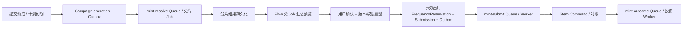

# Mint 架构

**当前 Profile**：`simple-layered`

> Mint 是自动任务业务应用，不是执行引擎。

> 2026-09-30 对齐 Maia 的 TS/Node.js/Fastify、TiDB/Drizzle 与 BullMQ；以下为目标设计，尚无本轮异步流程或观测验收结果。精确版本与公共约束继承 [Maia 架构](../ARCHITECTURE.md)。

## 1. 定位与边界

Mint 将联系人广播、群广播和群管理等业务意图解析成已授权、可审计的 Stem Task Command。它负责业务规则、目标解析、去重、频控、影响预览和结果汇总；Task/WorkflowRun/Todo/Execution 全部是 Stem 的规范运行事实，Mint 不直接控制 Celt/Vine，也不直连 Mud 数据库。

### Seed 依赖契约

Mint 按真实需求消费 Seed 已交付的 TS/npm 技术包，锁定版本与制品摘要，缺口通过当前 Story/Task 的 dependency 协作交付。Campaign、Resolver、业务频控、Drizzle 模型/查询/迁移及队列 processor 由 Mint 拥有；BullMQ 直接使用原生 SDK，不预建 MQ 公共服务或复制 Seed 实现。

## 2. 结构

HTTP/Consumer → Use Cases → 业务策略与 Task Command → Mud Resolvers / Stem Gateway。Resolver 分别解析 Account、Contact/Group、Content、Terminal policy、Plugin/Action/Workflow，并逐个校验 tenant、角色、Creator/Owner/User/有效 Own、关联实体、输入 Schema、发布状态和版本。Mint 只生成目标候选、权限来源与版本引用；Stem 在提交时重验并固化权威任务快照。

Mint 私有存储只保存业务参数预设、策略、提交记录和业务结果投影；预设只能引用已发布 Action/Workflow 版本，不得保存 Step、分支、失败或重试控制。公共资产归 Mud，WorkflowRun/Todo/Execution 归 Stem。跨服务使用版本化 HTTP；私有变更以 Outbox 发布，执行事件以 Inbox + 来源水位消费。

## 3. 核心流程

草稿 → Resolver → 目标去重/频控 → 影响预览 → 确认 → 提交 Stem Task Command → 订阅执行事件 → 按目标聚合。广播/群管理必须引用 Mud 已发布 Workflow 或 Action；流程节点/分支/子流程由 Stem 运行，Action Step/Operation 由 Celt 执行，Mint 不解释执行结构。

每个目标候选分配不可变 `target_snapshot_id`；Task Command、Todo 与执行事件都携带它，拆成多个 Todo 时另带 `target_unit_id`，聚合按目标及 Stem 的替代/重试关系计算。预览与确认绑定目标集、Content/Action/Workflow 版本、权限来源、参数摘要和过期时间；提交前重验。

频控由 Mint 的 FrequencyReservation 聚合唯一裁决：在 `(tenant, account, target, policy, window)` 上事务性占用额度并设唯一约束；Stem 接受 Task 后标记 consumed，提交失败释放，取消是否返还由版本化策略明确且不可事后改写。Mint 先持久化 reservation、submission id/idempotency key，再调用 Stem；超时按 key 对账，不创建第二个 Task。取消/暂停/重试/回放由权限入口调用 Stem，Mint 只更新业务投影。

结果投影保存 Stem event cursor、新鲜度和来源版本；检测断档后从 Stem 快照/重放接口补齐，乱序按版本合并。页面下钻 Stem 事实时由 Stem 重新鉴权，过期投影不得显示为实时状态。

### 3.1 业务模块和领域模型

| 模块 | 聚合/服务 | 规则 |
|---|---|---|
| Campaign Draft | CampaignDraft、AudienceSpec、DeliverySpec | 可编辑意图，不产生执行；保存版本 |
| Resolver | ResolutionSet、RejectedTarget | 固定来源/权限/实体版本，失败可解释 |
| Audience | TargetSnapshot、TargetUnit、DedupPolicy | 联系人/群统一目标协议，目标类型规则分离 |
| Policy | FrequencyPolicy、RiskPolicy、SchedulingPolicy | 策略版本化，不把流程节点藏在策略中 |
| Reservation | FrequencyReservation、Submission | 原子额度和跨服务幂等 |
| Projection | CampaignOutcome、TargetOutcome | 只读 Stem 事件，带 cursor/freshness |

联系人广播、群广播、群管理共享“草稿→目标解析→策略→提交→结果”的主流程，仅目标校验和结果聚合策略不同。新增业务类型实现 CampaignTypePolicy，不复制提交和投影流水线。

### 3.2 对外契约

- Command：create/update/preview/confirm/submit campaign；每次写入带 draft version 和 idempotency key。
- Query：campaign、target rejection、outcome、freshness；大目标集只返回分页摘要/导出引用。
- Stem Task Command 固定 campaign/draft/target snapshot/asset versions/frequency reservation/confirmation。
- 事件：`campaign.submitted/outcome.changed/completed`，只表达 Mint 业务状态，不复制 Todo/Execution payload。

### 3.3 产品化与非功能

- 性能：百万目标采用流式解析和分片 TargetSnapshot，不在 API 内存构造全量列表。
- 高可用：reservation/submission 本地事务；Stem 未知结果对账；投影断档重放。
- 安全：目标、内容、账号、Action、Workflow 分别授权；预览下载短期授权；频率和黑名单服务端强制。
- 可运营：按 rejected/duplicate/rate-limited/skipped/failed 分类，不以总成功率掩盖单目标失败。

路线：M0 Resolver/低风险单目标 → M1 联系人广播 → M2 群广播 → M3 群管理 → M4 模板/计划/运营报表 → M5 大规模分片与开放 CampaignType 扩展。

### 3.4 BullMQ 异步节点

对应 US-002～006/010/011/013，节点采用 [Maia 异步方案](../docs/architecture/async-jobs.md)：

| 工作 | 使用与边界 |
|---|---|
| 大目标集解析 | API 持久化 operation 后返回引用；`mint-resolve` Job 按分页/分片读取 Mud Resolver，I/O 有界并发，CPU 密集去重隔离到 sandboxed processor，禁止单 Job 装载全部目标 |
| 预览汇总 | 有限分片清单使用 FlowProducer，父 `preview.aggregate` 等必需子 Job 成功并核验持久结果后完成预览；必需分片失败传播至父项，不能用半成品请求确认 |
| 草稿重算 | 尚未确认且允许替换的同一草稿版本计算可防抖；取消或新版本使旧结果失效。运行中的计算仍须检查版本，不能假定 Debounce 会取消已运行 Job |
| 延迟/周期计划 | `mint-schedule` 使用 delay/Job Scheduler 唤醒保存的计划，执行前重验时点、版本、权限、确认有效性和取消；需逐时点完整的计划按水位有界补齐，不自动扩大已授权范围 |
| 提交与业务频控 | `mint-submit` Worker 使用稳定 Submission key 调用 Stem，未知结果先对账。FrequencyReservation 仍由 DB 事务和唯一约束裁决；BullMQ 限速只约束调用负载，不能替代业务发送额度 |
| 结果投影与导出 | `mint-outcome` Job 按 Stem 来源版本/水位更新目标结果；大导出异步生成受控对象引用，QueueEvents 仅通知进度，最终状态查询业务记录 |

Mint Flow 只组织解析和汇总计算；Action/WorkflowRun/Todo/Execution 的执行依赖、暂停和补偿由 Stem 拥有。取消先持久化业务状态，停止新增分片；在途结果提交前再次检查，清理 Job 不能代替业务取消。

按 [OTel 方案](../docs/architecture/observability.md) 关联 Campaign/operation/分片/Submission 与 Stem 引用，区分解析积压、CPU 时间、频控拒绝、提交等待和投影新鲜度。验收覆盖分片失败阻止汇总、重试不重复占额或提交、过期确认阻止计划执行、取消竞态和 Trace/Metrics/Logs 关联。

## 4. 迁移

既有模板只保留业务参数预设与 Mud Workflow/Action 引用，执行步骤归 Stem。涉及旧数据与接口时，在对应迭代技术方案按 Harness 规范确定迁移、校验和切换，不在架构预设发布版本或具体迁移执行步骤。高风险确认仍由 Stem 签发与验证。

## 5. 技术边界与质量

采用 Maia 已选 TS/Node.js/Fastify、TiDB/Drizzle 和 BullMQ，部署资源与运行配置只在 [部署设计](../docs/DEPLOYMENT.md) 维护。Test 使用真实 Mud/Stem/Celt 最小闭环，契约替身只用于单元测试。关键指标为解析失败、目标规模、频控拒绝、提交延迟、完成率和人工处置率。
